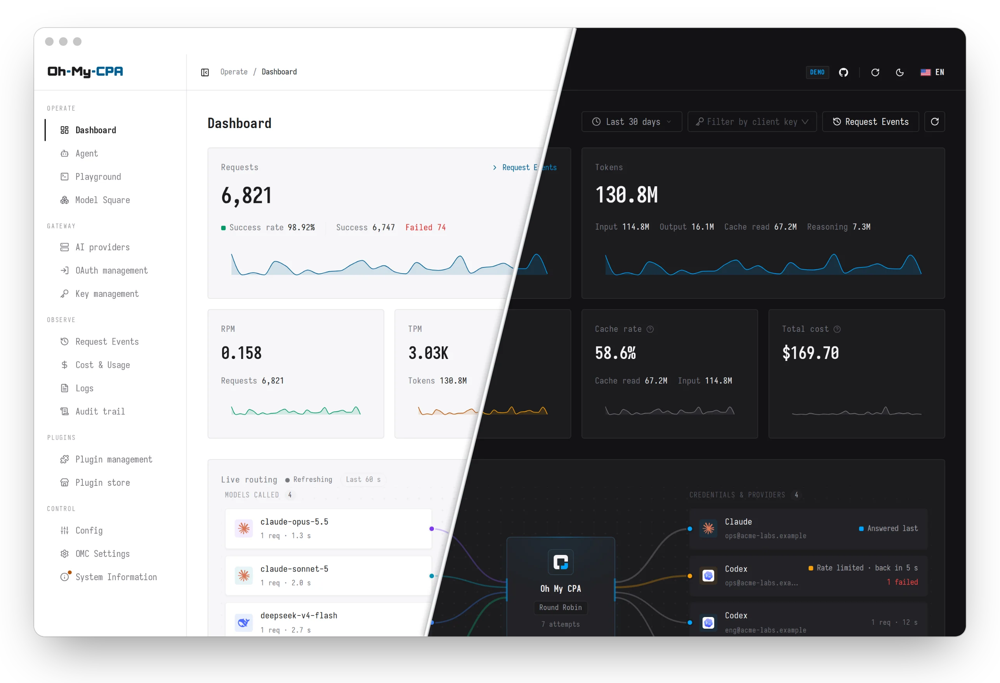
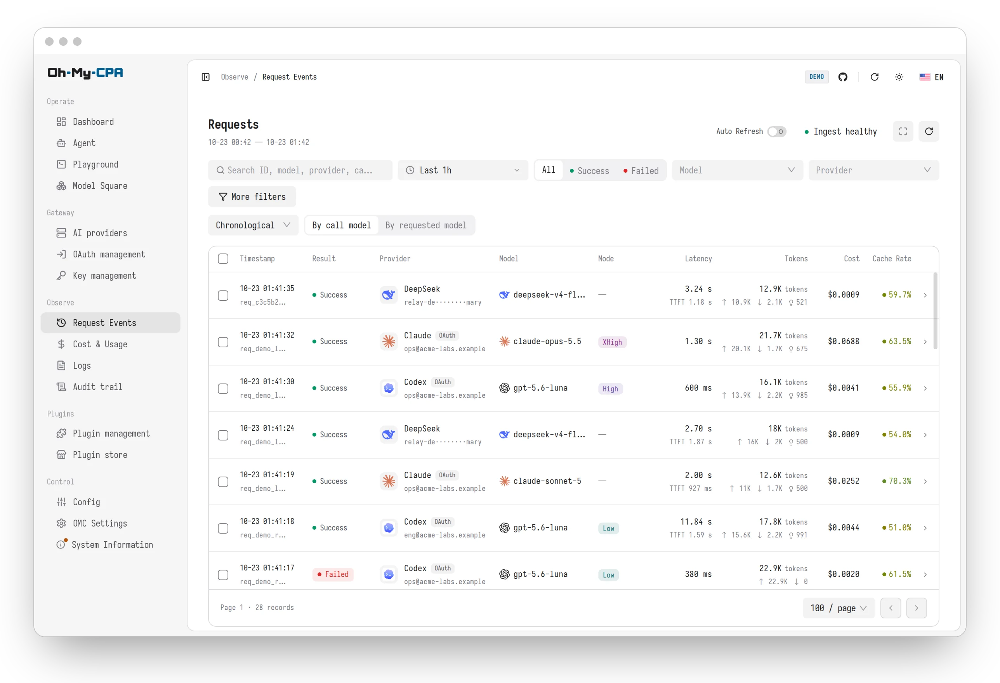
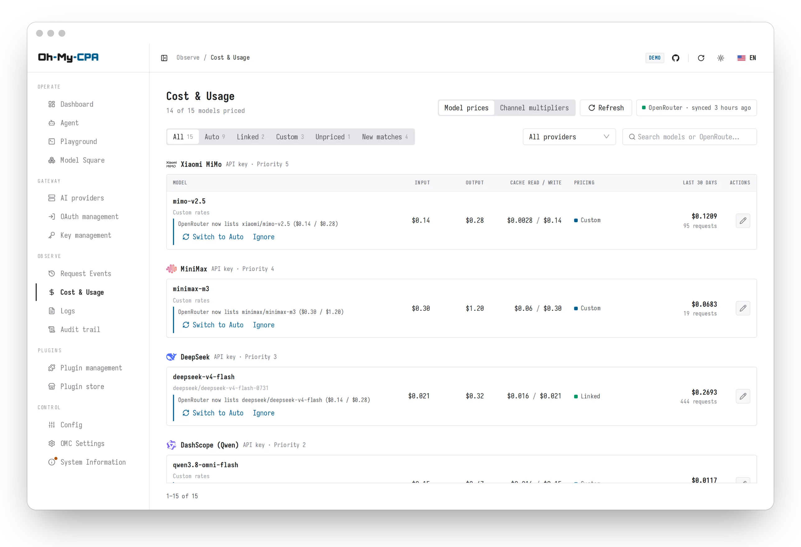
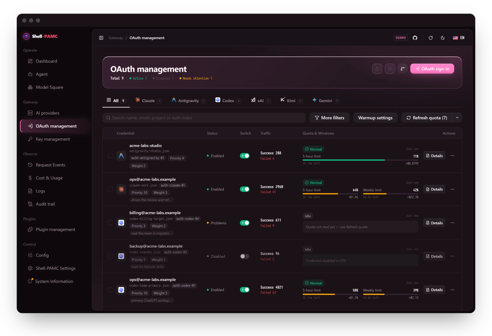
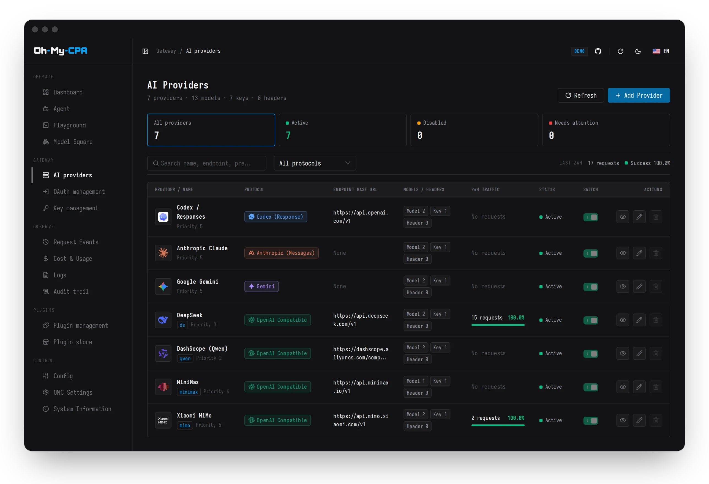
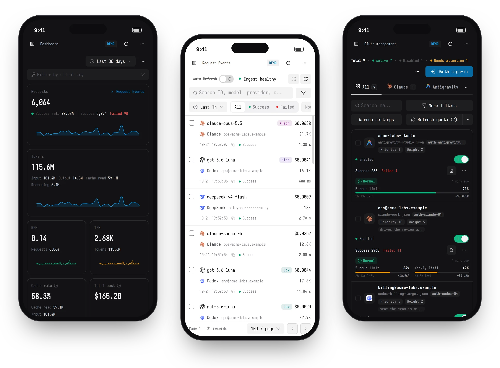

<div align="center">

<picture>
  <source media="(prefers-color-scheme: dark)" srcset="web/src/assets/brand/omc-wordmark-dark.svg">
  
</picture>

### Gestiona APIs y OAuth en un solo lugar, visualiza solicitudes, costos y uso

MCP · Visualización · Gestión

<br />

[](https://github.com/Bizasbot/Shell-PAMC/releases)
[](https://github.com/Bizasbot/Shell-PAMC/actions/workflows/ci.yml)
[](https://github.com/Bizasbot/Shell-PAMC/stargazers)
[](https://github.com/Bizasbot/Shell-PAMC/pkgs/container/shell-pamc)

[](LICENSE)

<br />

[Instalación](#instalación) ·
[Características](#características) ·
[Agentes y MCP](#agentes-y-mcp) ·
[Documentación](#documentación)

<br />

  

</div>

CLIProxyAPI (CPA) es una pasarela de API: adapta
protocolos, almacena credenciales y proxifica solicitudes. **Shell-PAMC** es una consola
web para ella. Shell-PAMC gestiona los proveedores, las credenciales y la configuración de la pasarela,
y registra el uso y costo de cada solicitud. Es un único binario
en Go con la consola React incrustada y una base de datos SQLite local, funciona sin conexión
e inicia sesión con la clave de administración de CPA.

## Capturas de pantalla

<table>
<tr>
<td width="50%" valign="top">

<p align="center"><b>Registros de solicitudes</b><br />Cada solicitud, filtrable por modelo, proveedor, clave, estado y costo</p>
</td>
<td width="50%" valign="top">

<p align="center"><b>Costos y uso</b><br />Un libro de precios cotejado desde OpenRouter, con anulaciones personalizadas</p>
</td>
</tr>
<tr>
<td width="50%" valign="top">

<p align="center"><b>Gestión de OAuth</b><br />Inicia sesión, inspecciona cuotas y configura cada credencial en un solo lugar</p>
</td>
<td width="50%" valign="top">

<p align="center"><b>Proveedores de IA</b><br />Endpoints, modelos, prioridad y un interruptor de activación aplicado por la pasarela</p>
</td>
</tr>
</table>

<div align="center">
  
  <p><b>Diseño móvil</b><br />Cada página se adapta a pantallas estrechas</p>
</div>

## Instalación

### Instalar con un agente

Pega lo siguiente en Claude Code, Codex, Cursor u otro agente de desarrollo. El agente
inspecciona la máquina, elige el método correspondiente y lo instala:

```text
Install Shell-PAMC for me by following
https://raw.githubusercontent.com/Bizasbot/Shell-PAMC/main/docs/install-for-agents.md
```

### Instalar con Docker Compose

Requiere Docker Engine con el plugin Compose y CLIProxyAPI v8.0.0 o posterior. Los
comandos asumen una shell de Linux o macOS con `curl` y `openssl`. La contraseña de
inicio de sesión de la consola es la clave de administración de CPA.

| Escenario | Método |
| --- | --- |
| CPA aún no está desplegado | [Nueva instalación](#nueva-instalación) |
| CPA está desplegado con Docker Compose | [CLIProxyAPI ya está instalado](#cliproxyapi-ya-está-instalado) |
| CPA está desplegado de otra manera | [Independiente (Standalone)](#independiente-standalone) |

#### Nueva instalación

Guarda lo siguiente como `compose.yml` en un directorio nuevo:

```yaml
services:
  cli-proxy-api:
    image: eceasy/cli-proxy-api:latest
    restart: unless-stopped
    ports:
      - "127.0.0.1:8317:8317"
    environment:
      MANAGEMENT_PASSWORD: ${CPA_MANAGEMENT_KEY:?}
    volumes:
      - ./config.yaml:/CLIProxyAPI/config.yaml
      - ./auths:/root/.cli-proxy-api
      - ./logs:/CLIProxyAPI/logs
      - ./plugins:/CLIProxyAPI/plugins

  shell-pamc:
    image: ghcr.io/bizasbot/shell-pamc:latest
    restart: unless-stopped
    depends_on:
      - cli-proxy-api
    ports:
      - "127.0.0.1:8080:8080"
    environment:
      SHELLPAMC_CPA_BASE_URL: http://cli-proxy-api:8317
      SHELLPAMC_CPA_MANAGEMENT_KEY: ${CPA_MANAGEMENT_KEY:?}
      SHELLPAMC_MASTER_KEY: ${SHELLPAMC_MASTER_KEY:?}
      SHELLPAMC_DATA_DIR: /data
    volumes:
      - shell-pamc-data:/data

  shell-pamc-updater:
    image: ghcr.io/bizasbot/shell-pamc:latest
    restart: unless-stopped
    command: ["updater", "serve"]
    user: "0:0"
    read_only: true
    cap_drop: [ALL]
    volumes:
      - /var/run/docker.sock:/var/run/docker.sock

volumes:
  shell-pamc-data:
```

En ese directorio, descarga la configuración inicial de CPA, genera las dos claves e inicia
ambos servicios:

```bash
curl -fsSL https://github.com/Bizasbot/Shell-PAMC/releases/latest/download/cpa.config.example.yaml -o config.yaml
printf 'CPA_MANAGEMENT_KEY=%s\nSHELLPAMC_MASTER_KEY=%s\n' "$(openssl rand -hex 24)" "$(openssl rand -hex 32)" > .env
chmod 600 .env
docker compose up -d
```

Abre **`http://127.0.0.1:8080/shell-pamc/`** e inicia sesión con el valor `CPA_MANAGEMENT_KEY`
de `.env`. Los proveedores y las claves de cliente se añaden en la consola; los clientes envían solicitudes
a CPA en `http://127.0.0.1:8317`.

#### CLIProxyAPI ya está instalado

Añade los servicios bajo `services:` en el archivo Compose que ejecuta CPA, y fusiona
`shell-pamc-data:` en la clave `volumes:` superior si existe. `cli-proxy-api` es
el nombre del servicio en el Compose propio de CPA; cámbialo si tu servicio tiene un nombre diferente.

```yaml
  shell-pamc:
    image: ghcr.io/bizasbot/shell-pamc:latest
    restart: unless-stopped
    ports:
      - "127.0.0.1:8080:8080"
    environment:
      SHELLPAMC_CPA_BASE_URL: http://cli-proxy-api:8317
      SHELLPAMC_CPA_MANAGEMENT_KEY: ${SHELLPAMC_CPA_MANAGEMENT_KEY:?}
      SHELLPAMC_MASTER_KEY: ${SHELLPAMC_MASTER_KEY:?}
      SHELLPAMC_DATA_DIR: /data
    volumes:
      - shell-pamc-data:/data

  shell-pamc-updater:
    image: ghcr.io/bizasbot/shell-pamc:latest
    restart: unless-stopped
    command: ["updater", "serve"]
    user: "0:0"
    read_only: true
    cap_drop: [ALL]
    volumes:
      - /var/run/docker.sock:/var/run/docker.sock

volumes:
  shell-pamc-data:
```

Añade dos líneas a `.env` en el mismo directorio:

```dotenv
SHELLPAMC_CPA_MANAGEMENT_KEY=<clave de administración de CPA en texto plano, no el hash de config.yaml>
SHELLPAMC_MASTER_KEY=<salida de: openssl rand -hex 32>
```

Añade también el servicio `shell-pamc-updater` del fragmento para actualizar desde la consola.
Ejecuta `docker compose up -d shell-pamc shell-pamc-updater`, lo que deja el contenedor de CPA
funcionando tal como está.
Abre **`http://127.0.0.1:8080/shell-pamc/`** e inicia sesión con la clave de administración.

#### Independiente (Standalone)

Guarda lo siguiente como `compose.yml` en un directorio nuevo. `SHELLPAMC_CPA_BASE_URL` es la
dirección de CPA vista desde dentro del contenedor: el valor a continuación alcanza un CPA en la misma
máquina que escucha en todas las interfaces, y [alcanzar CPA](docs/install.md#reaching-cpa)
enumera los demás casos.

```yaml
services:
  shell-pamc:
    image: ghcr.io/bizasbot/shell-pamc:latest
    restart: unless-stopped
    ports:
      - "127.0.0.1:8080:8080"
    extra_hosts:
      - host.docker.internal:host-gateway
    environment:
      SHELLPAMC_CPA_BASE_URL: http://host.docker.internal:8317
      SHELLPAMC_CPA_MANAGEMENT_KEY: ${SHELLPAMC_CPA_MANAGEMENT_KEY:?}
      SHELLPAMC_MASTER_KEY: ${SHELLPAMC_MASTER_KEY:?}
      SHELLPAMC_DATA_DIR: /data
    volumes:
      - shell-pamc-data:/data

  shell-pamc-updater:
    image: ghcr.io/bizasbot/shell-pamc:latest
    restart: unless-stopped
    command: ["updater", "serve"]
    user: "0:0"
    read_only: true
    cap_drop: [ALL]
    volumes:
      - /var/run/docker.sock:/var/run/docker.sock

volumes:
  shell-pamc-data:
```

Crea `.env` en el mismo directorio:

```dotenv
SHELLPAMC_CPA_MANAGEMENT_KEY=<clave de administración de CPA en texto plano, no el hash de config.yaml>
SHELLPAMC_MASTER_KEY=<salida de: openssl rand -hex 32>
```

Ejecuta `docker compose up -d`, luego abre **`http://127.0.0.1:8080/shell-pamc/`** e inicia sesión con
la clave de administración.

### Actualización

Con el servicio `shell-pamc-updater` activo, **Información del Sistema** en la consola muestra
**Actualizar ahora** junto a una versión más reciente de Shell-PAMC o CLIProxyAPI. El actualizador descarga
la imagen, reemplaza el contenedor manteniendo intactos sus ajustes, volúmenes y redes, y
restaura el contenedor anterior si el nuevo no arranca.

Un despliegue instalado antes de que existiera este servicio lo obtiene con un solo comando en el
host de Docker; el archivo Compose no se modifica:

```bash
docker run --rm --pull always -u 0 -v /var/run/docker.sock:/var/run/docker.sock ghcr.io/bizasbot/shell-pamc:latest updater install
```

El comando añade un contenedor `shell-pamc-updater` y actualiza Shell-PAMC a la versión
actual en el mismo paso. `docker rm -f shell-pamc-updater` lo elimina. Una imagen fijada a
un tag de versión nunca se actualiza desde la consola. [Actualizaciones](docs/install.md#upgrading)
describe cada caso y la alternativa manual.

### Instalar un ejecutable nativo

Los [Releases etiquetados](https://github.com/Bizasbot/Shell-PAMC/releases) incluyen ejecutables
para macOS (Darwin), Windows, Linux y FreeBSD, en amd64 y arm64. Cada archivo empaqueta
la consola e incluye una plantilla de entorno; verifique su hash SHA-256 contra el
`checksums.txt` de la versión. No se requiere Go, Node ni Docker. CPA debe instalarse
por separado. Siga la [guía de instalación nativa](docs/install.md#native-executable)
para configuración, permisos y actualizaciones.

### Notas

> [!IMPORTANT]
> Haga una copia de seguridad de `.env`. `SHELLPAMC_MASTER_KEY` cifra la base de datos, y los datos no pueden leerse
> sin ella.

CPA entrega cada registro de uso a un único lector. Si otro rastreador de uso lee el mismo
CPA, deténgalo, o añada `SHELLPAMC_USAGE_INGEST_MODE: "off"` bajo `environment:` para usar Shell-PAMC
únicamente para administración. Otros paneles de administración no generan conflicto.

`shell-pamc-updater` monta el socket de Docker, lo que equivale al control de Docker en ese
host. Las actualizaciones desde la consola se desactivan eliminando el servicio del archivo Compose y
removiendo su contenedor en ejecución con `docker rm -f shell-pamc-updater`; Compose deja funcionando
el contenedor cuyo servicio fue eliminado. Las actualizaciones luego se aplican con
`docker compose pull && docker compose up -d`.

La [guía de instalación](docs/install.md) cubre los archivos Compose protegidos publicados
con cada versión, acceso remoto, HTTPS, compilación desde código fuente, actualizaciones y
resolución de problemas.

## Características

<details open>
<summary><b>Pasarela y proveedores</b></summary>

- **Proveedores de IA**: Codex, Claude, Gemini, Meta Muse, xAI, Vertex AI, Gemini Interactions, DeepSeek y servicios compatibles con OpenAI, cada uno con credenciales, opciones avanzadas de modelo, políticas de reintento/error en tiempo de ejecución, prioridad, peso, proxy y un interruptor de activación aplicado por la pasarela.
- **Gestión de OAuth**: inicie sesión desde la consola para Codex, Claude, Antigravity, xAI, Kimi (kimi.com y kimi.ai), Devin y Meta Muse, o importe una clave de cuenta de servicio de Vertex. Los archivos de autenticación, la renovación manual de tokens, las listas de modelos, la cuota de Meta, las lecturas de planes en vivo de xAI/Antigravity y los alias específicos de credenciales se gestionan por credencial; los alias de modelo compartidos y las reglas de exclusión se aplican a nivel de proveedor. La capacidad de ventana se estima para Codex, Claude y grupos admitidos de Antigravity, mostrando el ciclo anterior como una referencia etiquetada. Las lecturas de cuota se actualizan aproximadamente un minuto después de que se reinicia una ventana y cada seis horas de forma predeterminada, ajustable en Ajustes de Shell-PAMC. El calentamiento de ventana de Codex/Claude agrega reinicio voluntario y programaciones diarias, anulaciones de credenciales y una solicitud mínima opcional confirmada. Las programaciones aprobadas verifican la cuota y facturación actual antes de enviar, luego observan la activación de la ventana.
- **Claves de cliente**: cree, nombre y revoque claves API de la pasarela. Los nombres aparecen en los registros y filtros de solicitudes.
- **Catálogo de modelos**: obtenga listas de modelos directamente de los proveedores de upstream.
- **Plugins**: plugins instalados, formularios de ajustes tipados y páginas de plugins confiables con compatibilidad nativa de administración/directorio de modelos de CPA. Consulte [el límite de confianza](docs/operations.md#plugin-pages).

</details>

<details>
<summary><b>Observabilidad</b></summary>

- **Panel de control (Dashboard)**: volumen de solicitudes, rendimiento de tokens, tasa de aciertos de caché y costo en intervalos preestablecidos de 15 minutos a 90 días, una ventana histórica total desde la instalación o cualquier rango personalizado, además de un mapa de calor de tokens anual. Las estadísticas se conservan de forma permanente; los registros de solicitudes se eliminan según una retención configurable.
- **Enrutamiento en vivo**: un minuto continuo de qué modelos fueron invocados y a qué credenciales y proveedores los envió CPA. Cada nueva solicitud recorre el mapa hasta su credencial y de vuelta, incluidos intentos redirigidos y enfriamientos. El panel se actualiza a medida que se almacenan los registros, recurre a sondeo corto si el stream en vivo no está disponible y se muestra en anchos de escritorio.
- **Paneles de modelos**: tendencia de tokens y anillo de uso por modelo invocado o por modelo solicitado, con distribución de costos.
- **Registros de solicitudes**: facetas de selección múltiple y búsqueda de texto completo; con la actualización automática activada, los nuevos registros aparecen tan pronto como se almacenan; un panel lateral de detalle con duración, TTFT, desglose de tokens y el registro en crudo por solicitud. Cada registro conserva el modelo que el upstream informó haber servido, y señala aquellos en los que difiere del modelo solicitado.
- **Recolección en segundo plano**: el uso se ingiere mediante stream o sondeo, incluso sin ningún navegador abierto.
- **Registros y pista de auditoría**: siga el registro de la pasarela en tiempo real, lea el registro de servicio propio de la consola y revise una pista de auditoría append-only con filtros y exportación a JSON.

</details>

<details>
<summary><b>Precios y costos</b></summary>

- **Instantáneas al momento de la solicitud**: el costo de una solicitud queda fijado por versiones de precio inmutables al completarse.
- **Libro de precios de OpenRouter**: cada modelo servido tarifado a partir de la lista pública de OpenRouter, incluyendo niveles de contexto largo y horarios del día.
- **Precios vinculados y personalizados**: vincule un modelo a una entrada de OpenRouter o configure tarifas personalizadas, con valores preestablecidos por niveles y calculadora.
- **Multiplicadores de canal**: escale todo lo que responde un proveedor, por ejemplo un repetidor facturado al 30% del catálogo.
- **Precios de modelo por canal**: asigne al mismo modelo diferentes tarifas personalizadas y niveles horarios en diferentes canales, con precios compartidos de forma predeterminada.

</details>

<details>
<summary><b>Configuración y seguridad</b></summary>

- **Editor de configuración de modo dual**: formularios estructurados o un editor Monaco YAML que preserva comentarios.
- **Respaldos automáticos de configuración**: una copia cifrada de `config.yaml` antes de cada cambio, restaurable desde la consola.
- **Cifrado en reposo**: las credenciales almacenadas y los mensajes de uso sin procesar se cifran con AES-GCM.
- **Acciones sensibles auditadas**: revelar claves, descargar archivos de autenticación y exportar registros se registran en la auditoría, y se rechazan si esa escritura falla.
- **Operación sin conexión**: los recursos empaquetados están incrustados en el binario; las fuentes instaladas y subidas son almacenadas y servidas por el propio despliegue. El navegador no se conecta a ninguna CDN.
- **Personalización**: cuatro idiomas de interfaz, temas claro y oscuro con paletas personalizadas, fuentes de interfaz y monoespaciadas desde una biblioteca de fuentes (empaquetadas, subidas o instaladas desde Google Fonts y servidas por la propia consola), zona horaria de despliegue y unidades numéricas K/M/B o 万/亿.

</details>

## Agentes y MCP

**En la consola:** En la página `/agent`, un modelo enrutado a través de CPA responde preguntas
y opera la consola: análisis de uso y solicitudes, proveedores, OAuth, cuota, claves
de cliente, configuración y precios. Las lecturas se ejecutan directamente. Los cambios se preparan en el servidor
y se ejecutan solo tras un Permitir en la consola. Secretos, tokens y autorización de OAuth
nunca ingresan al contexto del modelo. Las respuestas pueden combinar texto con componentes interactivos en línea que
aparecen mientras se generan: filtros locales, calculadoras, diagramas y gráficos. Los componentes
utilizan el sistema visual de la consola; los seguimientos que requieren nuevos datos o acciones permanecen en el
flujo de conversación revisado.

**Desde un agente externo:** Las mismas capacidades se sirven a través de MCP en
`<console URL>/api/mcp` (Streamable HTTP), de modo que un agente en otra máquina se conecta mediante
URL con la clave de administración de CPA como token portador. No se instala nada en el lado del
agente. La acción **Conectar** en la parte superior de `/agent` muestra el endpoint propio del despliegue
con configuración lista para copiar.

Claude Code:

```bash
claude mcp add --transport http shell-pamc https://cpa.example.com/shell-pamc/api/mcp \
  --header "Authorization: Bearer $SHELLPAMC_CPA_MANAGEMENT_KEY"
```

Codex (`~/.codex/config.toml`):

```toml
[mcp_servers.shell-pamc]
url = "https://cpa.example.com/shell-pamc/api/mcp"
bearer_token_env_var = "SHELLPAMC_CPA_MANAGEMENT_KEY"
```

Clientes configurados en JSON, como Cursor:

```json
{
  "mcpServers": {
    "shell-pamc": {
      "url": "https://cpa.example.com/shell-pamc/api/mcp",
      "headers": { "Authorization": "Bearer <CPA management key>" }
    }
  }
}
```

<details>
<summary>Clientes que solo admiten stdio</summary>

El binario incluye un puente stdio que reenvía hacia la consola:

```json
{
  "mcpServers": {
    "shell-pamc": {
      "command": "/path/to/shell-pamc",
      "args": ["mcp"],
      "env": {
        "SHELLPAMC_SERVER_URL": "https://cpa.example.com/shell-pamc",
        "SHELLPAMC_CPA_MANAGEMENT_KEY": "<CPA management key>"
      }
    }
  }
}
```

</details>

Un agente externo lee el estado y realiza escrituras de bajo riesgo, como nombres para mostrar y
preferencias, directamente. Cualquier otro cambio solo puede prepararlo: no puede aprobar la
operación, enviar un secreto ni completar un inicio de sesión de OAuth, y el cambio preparado devuelve un
enlace que abre su aprobación en la consola. La clave de administración equivale a privilegios de administrador, por lo que conecte únicamente
agentes de confianza y sirva la consola sobre HTTPS antes de conectar uno de forma remota.
[`docs/agent-capabilities.md`](docs/agent-capabilities.md) es el contrato.

## Configuración

| Variable | Valor por defecto | Propósito |
| --- | --- | --- |
| `SHELLPAMC_CPA_BASE_URL` | obligatorio | Dirección de CPA |
| `SHELLPAMC_CPA_MANAGEMENT_KEY` | obligatorio | Clave de administración de CPA y contraseña de inicio de sesión de la consola |
| `SHELLPAMC_MASTER_KEY` | obligatorio | Clave de cifrado en reposo (`openssl rand -hex 32`) |
| `SHELLPAMC_BASE_PATH` | `/shell-pamc` | Subruta bajo la cual se sirve la consola |
| `SHELLPAMC_DATA_DIR` | `./data` | Directorio de la base de datos SQLite; los archivos Compose establecen `/data` |
| `SHELLPAMC_PUBLIC_URL` | no establecido | La dirección que usan los navegadores; `https://` marca la cookie de sesión como `Secure` |
| `SHELLPAMC_USAGE_INGEST_MODE` | `auto` | `off` cuando otro servicio recolecta el uso de este CPA |
| `TZ` | zona del sistema | Calendario del servidor; manténgalo igual al de CPA. Los contenedores usan por defecto UTC |

La referencia completa, con restricciones de despliegue y notas operativas, está en
[`docs/operations.md`](docs/operations.md).

## Arquitectura

```text
Navegador ──▶ Listener directo / ingress HTTPS existente ──▶ Shell-PAMC (:8080)
                                                    ├─ SPA React incrustada (/shell-pamc/)
                                                    ├─ SQLite WAL (/data)
                                                    └─ Recolector de uso ──▶ CLIProxyAPI (:8317)
```

- **Binario único**: la consola React está incrustada en el ejecutable Go.
- **Réplica única**: SQLite en modo WAL, un proceso por directorio de datos.
- **Nativo de subruta**: servido bajo `/shell-pamc` de forma predeterminada (`SHELLPAMC_BASE_PATH`), compartiendo host con CPA.
- **Fachada con lista permitida**: las APIs ordinarias de la consola proyectan DTOs seguros; las páginas de plugins confiables usan el contrato nativo delimitado. URLs de destino arbitrarias siguen siendo rechazadas.

[`docs/architecture.md`](docs/architecture.md) contiene el mapa de módulos, flujos de datos e invariantes.

## Documentación

**Uso de Shell-PAMC**

| Documento | Contenido |
| --- | --- |
| [`docs/install.md`](docs/install.md) | Instalación, verificación, actualizaciones, resolución de problemas |
| [`docs/install-for-agents.md`](docs/install-for-agents.md) | La misma instalación, en pasos para un agente de desarrollo |
| [`docs/operations.md`](docs/operations.md) | Referencia de ajustes y notas operativas |
| [`docs/ops/sqlite-operations.md`](docs/ops/sqlite-operations.md) | Guía de respaldo, restauración y clave maestra |
| [`docs/agent-capabilities.md`](docs/agent-capabilities.md) | Contrato de capacidades del agente y puente MCP |
| [`docs/cpa-v8-compat.md`](docs/cpa-v8-compat.md) | Línea base de CPA v8 y reubicación de configuración |
| [`docs/cpamc-parity.md`](docs/cpamc-parity.md) | Paridad de características con el centro de administración oficial de CPA |

**Desarrollo de Shell-PAMC**

| Documento | Contenido |
| --- | --- |
| [`CONTRIBUTING.md`](CONTRIBUTING.md) | Configuración de desarrollo y flujo de verificación |
| [`AGENTS.md`](AGENTS.md) | El contrato que siguen los agentes de desarrollo en este repositorio |
| [`docs/architecture.md`](docs/architecture.md) | Límites de módulos, flujos de datos e invariantes |
| [`CONTEXT.md`](CONTEXT.md) · [`docs/design.md`](docs/design.md) | Vocabulario del dominio · sistema visual |
| [`docs/releasing.md`](docs/releasing.md) | Imágenes GHCR activadas por tag, archivos nativos y GitHub releases |
| [`docs/ops/cloudflare-demo.md`](docs/ops/cloudflare-demo.md) | Cómo se despliega la demostración pública |

## Contribuir

Los reportes de problemas y solicitudes de extracción son bienvenidos. El desarrollo requiere Go 1.26+, Node.js 22+ y
pnpm 11+:

```bash
pnpm install --frozen-lockfile
cp .env.example .env
pnpm dev          # Air + Vite con recarga rápida en http://127.0.0.1:5173/shell-pamc/
```

Ejecute `pnpm verify` y `pnpm check:ui` antes de hacer push.
[`CONTRIBUTING.md`](CONTRIBUTING.md) cubre la configuración y el flujo de trabajo de verificación.

## Seguridad

Informe vulnerabilidades de forma privada como se describe en [`SECURITY.md`](SECURITY.md), no en un
issue público.

## Agradecimientos

Shell-PAMC está construido sobre CLIProxyAPI, que
maneja la adaptación de protocolos, credenciales y proxificado de solicitudes.

Agradecimientos también a la [comunidad Linux.do](https://linux.do).

## Licencia

[MIT](LICENSE)
